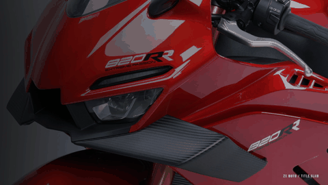
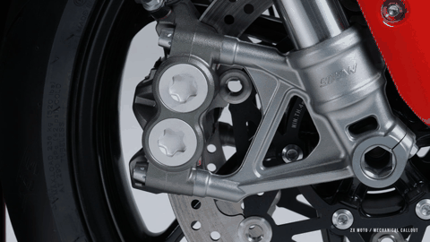
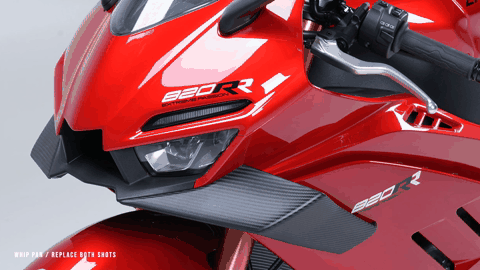
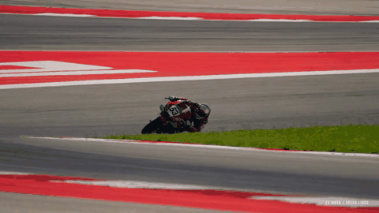
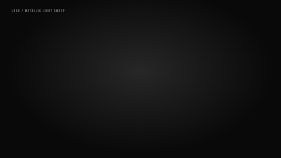

# Moto Motion Lab · 机车动效实验室

**[打开交互预览](https://liu2026liu123-cyber.github.io/moto-motion-lab/)**

五个独立的 Remotion 镜头动效，以及直接运行同一套组件的交互预览。播放、慢放、暂停、逐帧查看，拖动分界线比较原镜头与加入动效后的画面。调整文字、颜色、强度和位置时立即看到变化。

## 先看效果

| 标题冲入 | 机械细节标注 |
| --- | --- |
|  |  |
| **甩镜转场** | **速度线** |
|  |  |
| **Logo 金属扫光** | **交互调整** |
|  | [打开实验室](https://liu2026liu123-cyber.github.io/moto-motion-lab/)，试试慢放、逐帧、前后对比与实时改字改色。 |

| 动效 | 组件 | 可以调整 |
| --- | --- | --- |
| 标题冲入 | `TitleSlam` | 主副标题、短句、背景、颜色、冲入强度 |
| 机械细节标注 | `MechanicalCallout` | 部件名称、说明、锚点、引线终点、背景 |
| 甩镜转场 | `WhipPan` | 前后素材、源素材起点、方向、转场长度 |
| 速度线 | `SpeedLines` | 密度、速度、透明度、消失点、颜色 |
| Logo 金属扫光 | `LogoSweep` | Logo、标语、大小、颜色、动效强度 |

## 本地预览

需要 Node.js 22 或更新版本。

```bash
npm ci
npm run dev
```

打开 `http://localhost:4173`。网页支持本地图片预览；图片仅留在浏览器中，不会上传到服务器。

点击「下载当前配置」保存参数 JSON。替换了本地图片时，需要将图片放到 `public/assets/` 并填写素材路径后再导出。

## 导出视频与透明素材

```bash
# Remotion Studio
npm run studio

# 导出所有 MP4 预览与 ProRes 4444 透明 MOV
npm run render

# 使用网页下载的 title.json 导出自定义标题
npm run render -- --effect title --variant overlay --props title.json
```

网页预览与视频导出均使用 `src/effects/` 中的原生组件，不是播放一段固定的演示录像。默认 1920×1080、30 fps、无内置音乐。

**甩镜的透明 MOV 是配套遮罩。** 完整甩镜由 `WhipPan` 组件驱动前后素材的位移和模糊；它无法通过单个透明叠加视频自动移动剪辑软件的底层镜头。

更完整的参数说明和其他项目接入方式见 [使用说明](./使用说明.md)。

## 项目结构

```text
src/effects/       五个独立动效组件
src/shared.tsx    素材、字体与帧计算工具
src/Root.tsx      Remotion 导出入口
web/              交互预览界面与前后对比
config/           默认参数与修改示例
public/assets/    示例画面、Logo、字体及字体许可
scripts/          网页构建与视频导出
docs/             已构建的 GitHub Pages 页面
```

## 更新预览页面

```bash
npm run typecheck
npm run build
git add src web config scripts docs package.json package-lock.json
git commit -m "Update motion preview"
git push
```

GitHub Actions 在 `main` 更新时发布 `/docs` 中的已构建页面。网页无需服务端。

## 素材说明

示例照片、赛道片段和品牌 Logo 用于演示《张雪机车·向前》的镜头动效，其权利归原权利人；用于其他品牌时请换成对应素材。字体为 Noto Serif SC 和 Bebas Neue，许可文件随素材附带。

项目没有附带 Motion Array 付费工程、模板下载或音乐。
